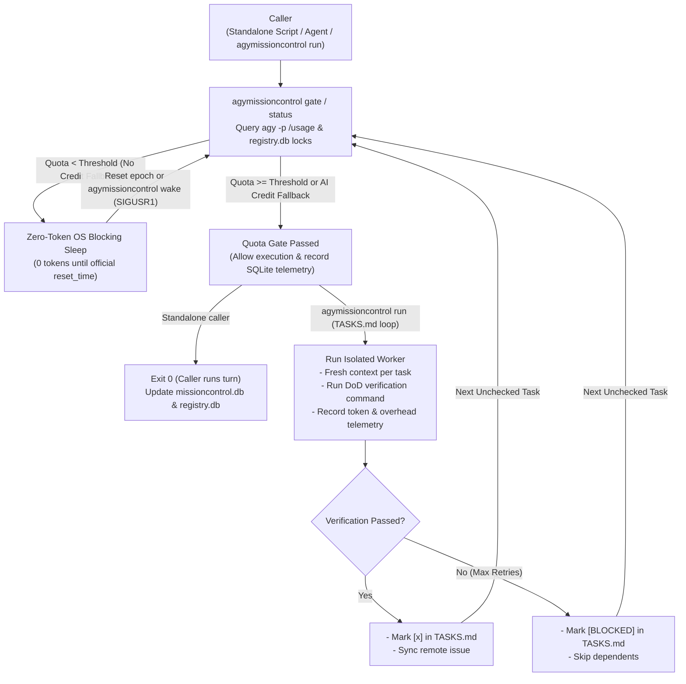
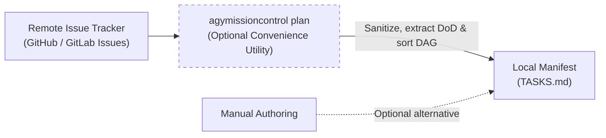

# Project Specification: agyMissionControl

Authoritative quota governor, zero-token sleep controller, and autonomous task runner for Google Antigravity (`agy`).

---

## 1. Executive Summary & Purpose

`agyMissionControl` is a deterministic quota governor, zero-token sleep controller, and multi-session CLI monitor for Google Antigravity (`agy`). Its primary job is preventing rate-limit crashes, runaway AI credit burn, and blind multi-repo quota exhaustion—with an optional context-isolated task runner and issue-to-manifest helper layered on top.

Core capabilities:
1. **Authoritative Quota Interception & Zero-Token Sleep:** Primary gatekeeper (`gate`/`status`) relying directly on live, official model quota telemetry via `agy -p "/usage" --output-format json` (capturing exact 5-hour rolling and weekly remaining percentages and recovery timestamps). When limits are hit, executes zero-token OS blocking sleeps until the official Google reset epoch or an early `SIGUSR1` wakeup (`wake`).
2. **Dual-Tier AI Credit & Overhead Governance:** Isolates Mission Control meta-tokens (prompt assembly, verification wrappers, error analysis) from coding work tokens in `missioncontrol.db`, calculating live Overhead %, Prompt Cache Hit Rate, and Estimated Dollar Costs ($). Directional token allowance metrics provide cost visibility, while go/no-go gating and optional credit fallbacks (`--max-credit-burn`) strictly follow authoritative `agy` usage.
3. **Multi-Project Registry & Live Cockpit:** Coordinates concurrent sessions across multiple repositories through an embedded SQLite registry (`registry.db`), with shared model lockout caches (`model_locks`), `ps`/`wake`/`stop`/`logs` controls, and a zero-dependency local web cockpit (`dashboard`).
4. **Context-Isolated Task Execution (`run`):** Optional autonomous runner (`agymissioncontrol run --detach`) that eliminates context degradation by executing tasks from `TASKS.md` in fresh, isolated agent contexts against explicit verification commands.
5. **Optional Backlog Bootstrapper (`plan`):** Decoupled convenience utility (`agymissioncontrol plan`) that converts GitHub/GitLab issues into `TASKS.md`. Completely optional—not required for `gate`, `status`, `dashboard`, or manual `TASKS.md` workflows.

---

## 2. Problems Solved

| Problem | Native Antigravity Behavior | `agymissioncontrol` Solution |
|---|---|---|
| **Rate Limit Hit** | Halts with error, pauses GUI, or silently burns paid credits (`AI Credit Overages: Always`). | Authoritative circuit breaker: queries `agy -p "/usage" --output-format json` for exact remaining % and reset timestamp, executing a zero-token OS sleep until official recovery (or capped weekly credit fallback). |
| **Unknown Tool Overhead** | Orchestrator burns hidden tokens on system prompts and verification without visibility. | Explicit `UsageTelemetry` model measuring work tokens vs Mission Control overhead tokens, cache hit rate %, and estimated USD cost. |
| **Multi-Project Collisions** | Running agents across multiple repositories leads to file write conflicts or unified quota burn without coordination. | Global SQLite coordinator (`registry.db`) with cross-project `model_locks`, isolated project ledgers (`missioncontrol.db`), and detached `--detach` session controls. |
| **Reasoning Token Burn** | Running high reasoning effort on simple tasks burns 6k–24k hidden thinking tokens on routine shell commands. | Enforces low reasoning effort on verification and execution workers, reserving high effort for logic and architecture. |
| **Multi-Ticket Runs** | A single continuous conversation balloons to hundreds of thousands of tokens, causing exponential quota drain and instruction drift. | `agymissioncontrol run` spawns a fresh agent context per task and uses local disk + Git as persistent state. |
| **Vague Issue Specs (Optional)** | Agent attempts ambiguous tasks without knowing how to verify success, hallucinating completion. | Optional `agymissioncontrol plan` pre-compiles tickets into `TASKS.md`, stripping noise and extracting verification commands (`pytest`, `cargo test`). |

---

## 3. Core Architecture & Workflows

Quota management and autonomous execution are intentionally decoupled from issue-tracker bootstrapping. Any external script, CI job, or Antigravity agent can use `gate` and `status` standalone without `plan` or `TASKS.md`.

### 3.1 Core Quota Governance & Execution Workflow (`gate`, `status`, `wake`, `run`)



### 3.2 Optional Task Manifest Generator (`agymissioncontrol plan`)

`agymissioncontrol plan` is a standalone, optional convenience helper for scaffolding `TASKS.md` from remote issues. You can skip it entirely when calling `gate`/`status`/`wake` directly or when writing `TASKS.md` by hand.



---

## 4. State & Concurrency: Hybrid Architecture

`agyMissionControl` maintains a strict separation between **Git-tracked human assets** and **high-performance local database telemetry**:

1. **Plain File Assets (Human & Git Domain)**:
   - `TASKS.md`: Human-readable Markdown checklist and DoD verification AST.
   - `.agymissioncontrol/logs/*.log`: Raw execution stdout/stderr streams.
   - `.agymissioncontrol/reports/*.md`: Project-scoped morning briefing reports.
2. **Engine & Concurrency Domain (Embedded `sqlite3` - Zero Dependencies)**:
   - `<project_dir>/.agymissioncontrol/missioncontrol.db`: Local project token ledger (`token_transactions` for work vs overhead tokens, cache hit rate, cost accounting, and directional allowance %) and project-scoped quota snapshots.
   - `~/.local/state/agymissioncontrol/registry.db`: Global multi-agent process coordinator (`sessions`), cross-project model lockout cache (`model_locks`), and unified account-wide time-series quota history (`quota_snapshots`) operating in SQLite WAL mode for atomic heartbeats, `ps` listing, dashboard charting, and early signal wakeups (`SIGUSR1`).

---

## 5. AI Credit & Dual-Tier Quota Governance

`agyMissionControl` implements an explicit dual-tier quota governor designed to prevent runaway cloud bills while maintaining development velocity:

| Tier | Window & Dynamics | Default Exhaustion Policy | Override Capability |
|---|---|---|---|
| **Continuous Rolling Quota** | 5-hour window; recovers in minutes to hours. | **Zero-Token Blocking Sleep (Free)**: Does NOT burn AI credits. Waits until the official `reset_time` reported by `agy -p "/usage" --output-format json`. | Calling agents can pass `--bypass-5h-quota` (or `--credit-trigger any`) to burn credits and avoid sleeping. |
| **Weekly Quota Allowance** | Fixed 7-day quota pool; resets weekly. | **AI Credit Fallback**: When weekly free allowance is exhausted, automatically taps paid AI credits if configured. | Strictly bounded by `--max-credit-burn` (USD); halts with `CREDIT_BUDGET_EXCEEDED` if cap is reached. |

### Hierarchical Calling Agent Cascade
1. **Catch-All Config (`.agymissioncontrol.yaml`)**: Establishes repository baseline policy (`policy: budget_capped`, `max_burn_usd: 10.00`, `trigger: weekly_only`). Routine unattended runs will never burn credits for 5-hour burst limits.
2. **Calling Agent CLI Overrides**: High-urgency or high-priority agents (e.g., automated release builders or urgent P0 bugfixers) can override project defaults on the fly:
   ```bash
   # Urgent agent run: bypass 5-hour rolling wait with credits up to $15.00
   agymissioncontrol run --bypass-5h-quota --max-credit-burn 15.00
   ```

---

## 6. CLI Interface Specification

```text
Usage: agymissioncontrol <command> [options]

Commands:
  gate        Check remaining quota and optionally block until reset
  status      Print real-time quota status and sliding window recovery timestamps
  ps          List all running and sleeping agents across all projects
  wake        Interrupt sleeping runners early via POSIX signal (by PID, project, or --all)
  stop        Gracefully stop running or sleeping detached agents (by PID, project, or --all)
  logs        Stream or tail logs for an active detached session
  dashboard   Start the local zero-dependency dark-mode web cockpit (localhost:8484)
  run         Execute the autonomous loop across tasks in TASKS.md (supports --detach)
  plan        (Optional) Fetch remote issues and build or update TASKS.md

Global Options:
  --project-dir        Target project workspace directory (default: current directory)
  --verbose            Enable debug logging
  --config             Path to agymissioncontrol.yaml (default: .agymissioncontrol.yaml)

Command: agymissioncontrol gate
  --model <NAME>       Model to evaluate quota for (default: primary model)
  --threshold <PCT>    Continuous 5-hour rolling threshold percentage (default: 15.0)
  --weekly-threshold   Weekly quota threshold percentage (default: 10.0)
  --credit-policy      Override AI credit policy: never | budget_capped | always
  --max-credit-burn    Override maximum AI credit dollar spend ceiling
  --credit-trigger     When to use credits: weekly_only | any (default: weekly_only)
  --bypass-5h-quota    Shortcut flag to bypass 5h rolling wait using AI credits
  --auto-sleep         Block and sleep until quota restores (default: true)
  --max-sleep <SECS>   Maximum blocking wait time in seconds

Command: agymissioncontrol status
  --model <NAME>       Model pool to inspect (default: all configured models)
  --json               Emit quota status as structured JSON

Command: agymissioncontrol ps
  --json               Emit session registry output as JSON

Command: agymissioncontrol wake [TARGET]
  --all                Wake all sleeping sessions across all projects

Command: agymissioncontrol stop [TARGET]
  --all                Stop all active and sleeping sessions across all projects

Command: agymissioncontrol logs [TARGET]
  --lines, -n <N>      Number of log lines to display (default: 50, follows live)

Command: agymissioncontrol dashboard
  --port <PORT>        Port to bind local dashboard (default: 8484)
  --no-browser         Do not automatically launch browser
  --detach, -d         Run dashboard server detached in background
  --stop               Stop running background dashboard instance

Command: agymissioncontrol run
  --manifest           Path to task manifest (default: TASKS.md)
  --model              Primary execution model (default: claude-3-7-sonnet)
  --fallback           Fallback model if primary is locked out (default: gemini-2.5-pro)
  --max-retries        Maximum failed verification attempts before marking BLOCKED (default: 3)
  --max-tasks          Maximum tasks to execute before halting (optional circuit breaker)
  --max-hours          Maximum wall-clock hours before halting (optional circuit breaker)
  --max-token-budget   Cumulative session token budget ceiling (circuit breaker)
  --credit-policy      AI credit policy: never | budget_capped | always (default: from config)
  --max-credit-burn    Maximum AI credit dollar spend ceiling (default: from config)
  --credit-trigger     When to use credits: weekly_only | any (default: weekly_only)
  --bypass-5h-quota    Shortcut flag to burn credits for 5h rolling limits
  --stop-on-block      Halt session immediately if any task is marked BLOCKED
  --fail-fast          Abort on first verification failure
  --detach, -d         Run detached in background; print PID and stream logs to file
  --sync-remote        Close remote GitHub/GitLab issue on success (default: true)

Command: agymissioncontrol plan (optional)
  --issue <NUM>        Ingest single remote issue by number
  --milestone <NAME>   Ingest all issues in a milestone
  --label <NAME>       Filter remote issues by label
  --provider <NAME>    Tracker CLI adapter: github | gitlab (default: auto)
  --default-test <CMD> Fallback test command for DoD verification (e.g. pytest)
  --output <PATH>      Output manifest path (default: TASKS.md)
  --suggest-order      Sort tasks topologically by dependencies (default: true)
  --dry-run            Print generated tasks without writing to file
```

---

## 7. Development Roadmap

`agyMissionControl` is organized into **3 Semantic Release Milestones** across **5 Epics (`E00` – `E04`)** and **25 granular task specifications**:
- **Milestone v0.1.0-alpha (Foundational Setup & Quota Gatekeeper):** Workspace setup, developer tooling (`Taskfile.yml`), permissions guardrails, dual-tier quota governor (`gate`/`status`), embedded SQLite ledger (`missioncontrol.db`), AI credit budget governance, and Mission Control overhead accounting.
- **Milestone v0.2.0-beta (Auxiliary Bootstrapper & Autonomous Execution Runner):** Issue-to-manifest compiler (`plan`), topological dependency DAG, autonomous supervisor loop (`run` with native `--detach`), closed stdin, timeout protection, pre-flight baseline checks, per-task quota/token metering, credit circuit breaker, and public GitHub Actions release pipeline.
- **Milestone v1.0.0 GA (Multi-Agent Registry & Live Web Cockpit):** SQLite-backed multi-agent process registry (`registry.db`), CLI `ps`/`wake`/`stop`/`logs`, early wakeups via `SIGUSR1`, and zero-dependency dark-mode web cockpit (TypeScript + Alpine.js + Lucide) on `localhost:8484`.

---

## 8. License

Open source under the [MIT License](LICENSE).
