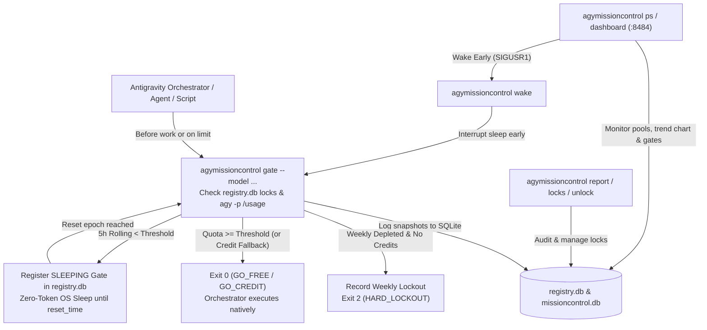
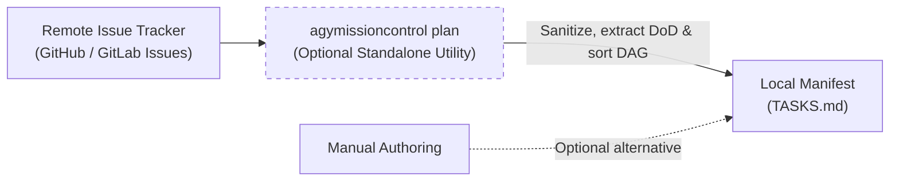

# Project Specification: agyMissionControl

[](https://github.com/alepuccetti/agy-missioncontrol/actions/workflows/ci.yml)
[](https://github.com/alepuccetti/agy-missioncontrol/actions/workflows/codeql.yml)
[](https://github.com/alepuccetti/agy-missioncontrol/actions/workflows/security-audit.yml)
[](https://scorecard.dev/viewer/?uri=github.com/alepuccetti/agy-missioncontrol)
[](https://github.com/alepuccetti/agy-missioncontrol/releases)
[](LICENSE)

Authoritative quota governor, zero-token sleep controller, and live quota cockpit for Google Antigravity (`agy`).

---

## 1. Executive Summary & Purpose

`agyMissionControl` is a deterministic quota governor, zero-token sleep controller, and live quota cockpit for Google Antigravity (`agy`). Rather than re-implementing Antigravity's native **Orchestrator**, it focuses strictly on preventing rate-limit lockouts, uncontrolled AI credit burn, and cross-repository quota collisions across long-running unattended sessions:

1. **Authoritative Quota Interception & Zero-Token Sleep:** Primary gatekeeper (`gate` / `status`) relying directly on live, official model quota telemetry via `agy -p "/usage" --output-format json` (capturing exact 5-hour rolling and weekly remaining percentages and recovery timestamps). When 5-hour limits are reached, executes zero-token OS blocking sleeps until the official reset epoch or an early `SIGUSR1` wakeup (`wake`).
2. **Dual-Tier AI Credit & Spend Governance:** Keeps 5-hour rolling waits free by default while supporting configurable paid AI credit fallback on weekly depletion (`--max-credit-burn` caps). Records credit burn, token/overhead analytics, and directional allowance metrics in `<project_dir>/.agymissioncontrol/missioncontrol.db`, while gating strictly on authoritative `agy` telemetry.
3. **Cross-Project Registry, Early Wakeup & Live Cockpit:** Coordinates concurrent sessions across repositories in global `~/.local/state/agymissioncontrol/registry.db` (`model_locks`, active/sleeping `gate` `sessions`, unified `quota_snapshots`), exposing `ps`/`wake`/`stop`, lock control (`locks`/`unlock`), quota reports (`report`), and a zero-dependency web cockpit (`dashboard`).
4. **Optional Backlog Bootstrapper (`plan`):** Preserves `agymissioncontrol plan` as a decoupled standalone helper that compiles GitHub/GitLab issues into a dependency-ordered `TASKS.md` checklist when desired—never required for quota gating or Orchestrator workflows.

---

## 2. Problems Solved

| Problem | Native Antigravity Behavior | `agymissioncontrol` Solution |
|---|---|---|
| **Rate Limit Hit** | Halts with error, pauses GUI, or silently burns paid credits (`AI Credit Overages: Always`). | Authoritative circuit breaker (`gate`): queries `agy -p "/usage" --output-format json` and executes a zero-token OS sleep until official recovery (or capped weekly credit fallback). |
| **Multi-Project Quota Collisions** | Running Antigravity Orchestrator sessions across multiple repositories burns shared model pools without coordination. | Global SQLite registry (`registry.db`) shares `model_locks` across repos so peer sessions sleep without hammering rate-limited endpoints. |
| **Blind Sleep & No Remote Control** | Background sleep waits cannot be inspected or resumed early across active repos. | Tracks sleeping `gate` PIDs in `registry.db`, inspected via `agymissioncontrol ps` / `dashboard` and woken early via `wake` (`SIGUSR1`) or terminated via `stop` (`SIGTERM`). |
| **Unknown Quota History & Credit Burn** | Point-in-time `/usage` checks provide no historical burn curve or cumulative AI credit cap enforcement. | Time-series `quota_snapshots` and `token_transactions` ledgers power `status`, `report`, and live SVG trend charts on `localhost:8484`. |
| **Issue-to-Checklist Scaffolding (Optional)** | Raw GitHub/GitLab tickets contain noisy templates, HTML comments, and implicit `blocked by` links. | Optional standalone `agymissioncontrol plan` strips noise, resolves dependency DAGs, and writes `TASKS.md` cleanly. |

---

## 3. Core Architecture & Workflows

Quota governance is intentionally decoupled from task orchestration and issue bootstrapping. Antigravity's native **Orchestrator**, hooks, or CI scripts call `agymissioncontrol gate` and `status` directly without needing `TASKS.md` or `plan`.

### 3.1 Core Quota Governance & Orchestrator Workflow (`gate`, `status`, `wake`, `ps`, `dashboard`, `report`)



### 3.2 Optional Task Manifest Generator (`agymissioncontrol plan`)

`agymissioncontrol plan` is a standalone, optional convenience helper for scaffolding `TASKS.md` from remote issues. You can skip it completely when calling `gate`/`status`/`wake`/`dashboard` directly with the native Orchestrator.



---

## 4. State & Concurrency: Hybrid Architecture

`agyMissionControl` maintains a strict separation between **human-readable exports** and **high-performance embedded SQLite telemetry**:

1. **Plain File Assets:**
   - `.agymissioncontrol/reports/*.md` & `*.json`: Project-scoped quota consumption and credit spend reports (`agymissioncontrol report`).
   - `TASKS.md` *(optional)*: Standalone markdown checklist generated if you run `agymissioncontrol plan`.
2. **Engine & Concurrency Domain (Embedded `sqlite3` WAL Mode — Zero Dependencies):**
   - `<project_dir>/.agymissioncontrol/missioncontrol.db`: Project-scoped `quota_snapshots` and `token_transactions` ledger (credit spend caps, cost accounting, and directional metrics).
   - `~/.local/state/agymissioncontrol/registry.db`: Global multi-session coordinator storing cross-project `model_locks`, unified time-series `quota_snapshots`, and live/sleeping `gate` process `sessions` (`busy_timeout = 30000`, dead PID auto-pruning via `os.kill(pid, 0)`, and `SIGUSR1` wakeup support).

---

## 5. AI Credit & Dual-Tier Quota Governance

`agyMissionControl` implements an explicit dual-tier quota governor designed to prevent runaway cloud bills while keeping development moving:

| Tier | Window & Dynamics | Default Exhaustion Policy | Override Capability |
|---|---|---|---|
| **Continuous Rolling Quota** | 5-hour window; recovers in minutes to hours. | **Zero-Token Blocking Sleep (Free)**: Does NOT burn AI credits. Waits until the official `reset_time` reported by `agy -p "/usage" --output-format json`. | Callers can pass `--bypass-5h-quota` (or `--credit-trigger any`) to burn credits and avoid sleeping. |
| **Weekly Quota Allowance** | Fixed 7-day quota pool; resets weekly. | **AI Credit Fallback**: When weekly free allowance is exhausted, automatically taps paid AI credits if configured. | Strictly bounded by `--max-credit-burn` (USD); exits `2` (`HARD_LOCKOUT`) if disabled or cap reached. |

### Hierarchical Calling Agent Cascade
1. **Catch-All Config (`.agymissioncontrol.yaml`)**: Establishes repository baseline policy (`policy: budget_capped`, `max_burn_usd: 10.00`, `trigger: weekly_only`). Routine unattended runs never burn credits for 5-hour burst limits.
2. **Calling Agent CLI Overrides**: Urgent Orchestrator steps can override project defaults on the fly:
   ```bash
   # Urgent turn: bypass 5-hour rolling wait with credits up to $15.00
   agymissioncontrol gate --model claude-3-7-sonnet --bypass-5h-quota --max-credit-burn 15.00
   ```

---

## 6. CLI Interface Specification

```text
Usage: agymissioncontrol <command> [options]

Commands:
  gate        Check remaining quota and optionally block in zero-token sleep until reset
  status      Print real-time dual-tier quota status, reset timers, and shared locks
  report      Generate quota usage, reset history, and credit spend reports from SQLite
  locks       List active cross-project model locks in registry.db
  unlock      Clear an active model lock (by model name or --all)
  ps          List all active and sleeping gate processes across all projects
  wake        Interrupt sleeping gates early via SIGUSR1 (by PID, project, label, or --all)
  stop        Gracefully stop active or sleeping gates via SIGTERM (by PID, project, label, or --all)
  dashboard   Start the local zero-dependency dark-mode quota cockpit (localhost:8484)
  plan        (Optional) Fetch remote issues and compile a dependency-ordered TASKS.md

Global Options:
  --project-dir        Target project workspace directory (default: current directory)
  --config             Path to .agymissioncontrol.yaml (default: .agymissioncontrol.yaml)

Command: agymissioncontrol gate
  --model, -m <NAME>   Model or quota pool to evaluate (default: configured primary model)
  --label <TEXT>       Optional context label shown in `ps` and the web cockpit (e.g. orchestrator task)
  --threshold <PCT>    Continuous 5-hour rolling threshold percentage (default: 15.0)
  --weekly-threshold   Weekly quota threshold percentage (default: 10.0)
  --credit-policy      Override AI credit policy: never | budget_capped | always
  --max-credit-burn    Override maximum AI credit dollar spend ceiling
  --credit-trigger     When to use credits: weekly_only | any (default: weekly_only)
  --bypass-5h-quota    Shortcut flag to bypass 5h rolling wait using AI credits
  --auto-sleep         Block in zero-token sleep until quota restores (default: true; --no-auto-sleep exits 1)
  --max-sleep <SECS>   Maximum blocking wait time in seconds before returning LOW_QUOTA (exit 1)
  --mock               Use deterministic mock telemetry instead of invoking external `agy` CLI

Command: agymissioncontrol status
  --json               Emit dual-tier quota, credit policy, and lock status as JSON
  --mock               Use deterministic mock telemetry instead of invoking external `agy` CLI

Command: agymissioncontrol report
  --since <DURATION>   Filter ledger history (e.g. 24h, 7d, ISO timestamp)
  --format <FMT>       Output format: rich | md | json (default: rich)
  --write/--no-write   Save Markdown/JSON report under .agymissioncontrol/reports/

Command: agymissioncontrol locks / unlock
  locks --json         List active shared model locks across projects
  unlock [MODEL]       Clear shared lock for MODEL (or --all to clear all locks)

Command: agymissioncontrol ps
  --json               Emit active/sleeping gate registry sessions as JSON

Command: agymissioncontrol wake [TARGET] / stop [TARGET]
  --all                Target all sleeping/active gate processes across all projects

Command: agymissioncontrol dashboard
  --port <PORT>        Port to bind local dashboard (default: 8484)
  --no-browser         Do not automatically launch browser
  --detach, -d         Run dashboard server detached in background
  --stop               Stop running background dashboard instance

Command: agymissioncontrol plan (optional)
  --issue <NUM>        Ingest single remote issue by number
  --milestone <NAME>   Ingest all issues in a milestone
  --label <NAME>       Filter remote issues by label
  --provider <NAME>    Tracker CLI adapter: auto | github | gitlab | mock (default: auto)
  --default-test <CMD> Fallback test command for DoD verification (e.g. pytest)
  --output, -o <PATH>  Output manifest path (default: TASKS.md)
  --suggest-order      Sort tasks topologically by dependencies (default: true)
  --dry-run            Print generated tasks without writing to file
  --fixture <PATH>     JSON/YAML fixture file for offline mock issue ingestion
```

---

## 7. Development Roadmap

`agyMissionControl` is organized into **3 Semantic Release Milestones** covering quota governance, reporting, multi-session visibility, and the optional standalone `plan` helper:
- **Milestone v0.1.0 (Foundational Setup & Quota Gatekeeper — Completed):** Workspace setup, developer tooling (`Taskfile.yml`), permissions guardrails, dual-tier quota governor (`gate` / `status`), embedded SQLite WAL ledgers (`missioncontrol.db`, `registry.db`), shared cross-project locks, AI credit budget governance, and zero-token sleep engine.
- **Milestone v0.2.0 (Optional `plan` Helper, Quota Reports & Public Releases — Completed):** Standalone optional `plan` tool (completed), quota & credit reporting (`report`), shared lock CLI control (`locks` / `unlock`), and automated public GitHub Releases (`darwin-arm64` & `linux-x86_64` binaries + plugin bundle).
- **Milestone v1.0.0 GA (Multi-Session Gate Registry & Live Quota Cockpit):** SQLite-backed active/sleeping `gate` registry (`registry.db`), `ps` / `wake` / `stop` early wakeup control (`SIGUSR1`), zero-dependency dark-mode quota cockpit (TypeScript + Alpine.js + Lucide + historical SVG charts) on `localhost:8484`, and Antigravity Orchestrator skill + IDE status pill.

---

## 8. Security, Quality Checks & Repository Setup

### Automated Workflow & Repository Checks

| Check | Trigger | Scope |
|---|---|---|
| **CI Pipeline** (`.github/workflows/ci.yml`) | Push / PR to `main` | Ruff format & lint, `pytest`, TypeScript typecheck + Vite build (`task ui:build`), and PyInstaller binary compilation on `ubuntu-24.04` & `macos-15`. |
| **CodeQL Security & Quality** (`.github/workflows/codeql.yml`) | Push / PR to `main`, weekly | Static security & code-quality analysis (`security-and-quality` suite) across `python`, `javascript-typescript`, and `actions` (ignoring compiled static assets via `.github/codeql/codeql-config.yml`). |
| **Dependency Review** (`.github/workflows/dependency-review.yml`) | PR to `main` | Blocks PRs introducing dependencies with `moderate` or higher vulnerabilities. |
| **Security & Dependency Audit** (`.github/workflows/security-audit.yml`) | Push / PR to `main`, weekly | Audits locked Python dependencies (`pip-audit` via `uv export`) and frontend dependencies (`pnpm audit --audit-level=moderate`). |
| **OpenSSF Scorecard** (`.github/workflows/scorecard.yml`) | Push to `main`, ruleset change, weekly | Evaluates supply-chain security posture and uploads SARIF results to GitHub Code Scanning. |
| **Dependabot Version Updates** (`.github/dependabot.yml`) | Weekly | Automated grouped dependency update PRs for `uv`, `npm` (`/src/agymissioncontrol/ui/frontend`), and `github-actions` with a 3-day cooldown. |
| **Release Attestations** (`.github/workflows/release.yml`) | Tag `v*.*.*` | Generates SHA-256 checksums and SLSA build provenance attestations (`actions/attest@v4`) verifiable via `gh attestation verify`. |
| **Security Policy** (`SECURITY.md`) | Always active | Directs vulnerability disclosures to GitHub Private Vulnerability Reporting. |

### Package Installation Cooldown (3 Days) & Emergency Bypass

To reduce supply-chain risk from newly published or compromised packages, both Python and frontend package managers enforce a **3-day release age cooldown**:

- **Python (`uv`)**: Configured in `pyproject.toml` (`[tool.uv] exclude-newer = "3 days"`) and recorded in `uv.lock` (`exclude-newer-span = "P3D"`).
- **Frontend (`pnpm`)**: Configured in `src/agymissioncontrol/ui/frontend/pnpm-workspace.yaml` (`minimumReleaseAge: 4320` minutes).
- **Dependabot**: Configured in `.github/dependabot.yml` (`cooldown.default-days: 3`) for `uv` and `npm`.

#### Emergency Bypass Options

1. **One-off global bypass (local / urgent sync):**
   - Python: `task install:bypass` (or `UV_EXCLUDE_NEWER=false uv sync --dev` / `uv lock --exclude-newer false`)
   - Frontend: `task ui:install:bypass` (or `PNPM_CONFIG_MINIMUM_RELEASE_AGE=0 pnpm --prefix src/agymissioncontrol/ui/frontend install` / `--config.minimumReleaseAge=0`)
2. **Targeted per-package exemption (recommended for an urgent CVE patch in CI):**
   - Python: Add `<package-name> = false` under `[tool.uv.exclude-newer-package]` in `pyproject.toml` (or run `uv lock --upgrade-package <package-name> --exclude-newer-package <package-name>=false`).
   - Frontend: Add `<package-name>` to `minimumReleaseAgeExclude` in `src/agymissioncontrol/ui/frontend/pnpm-workspace.yaml`.
   - Dependabot: Add the package name to `cooldown.exclude` in `.github/dependabot.yml` if needed for scheduled updates.

### Manual GitHub Repository Settings Checklist

After merging these workflows to `main`, enable the remaining free GitHub features in the repository settings UI:

1. **Code Security & Analysis** (`Settings → Code security`, `/settings/security_analysis`):
   - **Dependency graph**: Enable.
   - **Dependabot alerts**: Enable.
   - **Dependabot security updates**: Enable (and optionally **Grouped security updates**).
   - **Private vulnerability reporting**: Enable.
   - **Secret scanning & Push protection**: Verify enabled (with **Validity checks** and **Non-provider patterns** enabled if available).
   - **Code scanning**: **Do not** enable *Default setup*—Advanced setup is already configured via `.github/workflows/codeql.yml` and activates automatically once merged to `main`.
2. **Branch Rulesets (`main`)** (`Settings → Rules → Rulesets → main`):
   - Keep **Restrict deletions**, **Block force pushes**, and **Require signed commits** enabled.
   - Enable **Require a pull request before merging** (set required approvals as desired).
   - Enable **Require status checks to pass** and add:
     - `Lint, Test & Validate (ubuntu-24.04)`
     - `Lint, Test & Validate (macos-15)`
     - `Analyze (python)`
     - `Analyze (javascript-typescript)`
     - `Analyze (actions)`
     - `Review Dependency Changes`
     - `Python Dependency Audit (pip-audit)`
     - `Frontend Dependency Audit (pnpm audit)`
   - Enable **Require code scanning results** to block PRs introducing new CodeQL security or code-quality alerts.
3. **General Settings** (`Settings → General`):
   - Enable **Automatically delete head branches** under **Pull Requests**.
   - Enable **Immutable releases** under **Releases** to prevent tag or release asset tampering after publication.

---

## 9. License

Open source under the [MIT License](LICENSE).
