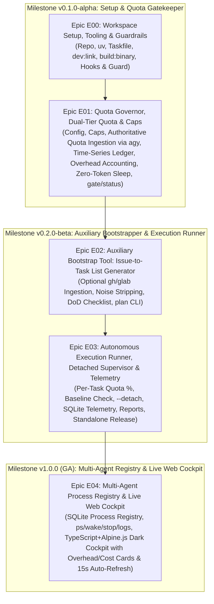

# Project Roadmap: agyMissionControl (Versioned)

Autonomous task orchestrator, quota governor, and issue-to-spec compiler for Google Antigravity (`agy`).

---

## 1. Versioned Release Milestones & Architecture

`agyMissionControl` is organized into **3 Semantic Release Milestones** across **5 Epics (`E00` – `E04`)** and **25 granular, test-driven task specifications**:

---

## 2. Release Milestones & Epics Index

| Milestone | Epic ID | Epic Title | Tasks | Status |
| :--- | :--- | :--- | :---: | :---: |
| **`v0.1.0-alpha`** | **[E00](./E00/EPIC.md)** | Workspace Setup, Developer Tooling & Permissions Guardrails | 5 | `[ ] TODO` |
| | **[E01](./E01/EPIC.md)** | Quota Governor, Dual-Tier Quota & Session Circuit Breakers (`gate` / `status`) | 5 | `[ ] TODO` |
| **`v0.2.0-beta`** | **[E02](./E02/EPIC.md)** | Auxiliary Bootstrap Tool: Issue-to-Task List Generator (`plan` / `TASKS.md`) | 5 | `[ ] TODO` |
| | **[E03](./E03/EPIC.md)** | Autonomous Execution Runner, Detached Supervisor & Telemetry (`run`) | 5 | `[ ] TODO` |
| **`v1.0.0` (GA)** | **[E04](./E04/EPIC.md)** | Multi-Agent Process Registry & Live Web Cockpit (`dashboard` / `ps` / `wake`) | 5 | `[ ] TODO` |
| **TOTAL** | | | **25** | |

---

## 3. Complete Task Directory & Specification Links

> Execution signals (`⚡ Direct`, `🧠 Deep Verify`, `🐝 Parallel`) are governed by [AGENT_ARCHITECTURE_PLAN.md](../AGENT_ARCHITECTURE_PLAN.md).

### Milestone `v0.1.0-alpha`: Setup & Quota Gatekeeper

#### [Epic E00: Workspace Setup, Developer Tooling & Permissions Guardrails](./E00/EPIC.md)
* **[E00-T01](./E00/T01-git-init-and-ignore.md):** `[⚡ Direct]` `[x] DONE` — Git Repository Initialization, MIT License, Branch Protection Baseline & `.gitignore`
* **[E00-T02](./E00/T02-python-packaging-and-uv-setup.md):** `[⚡ Direct]` — Modern Python Packaging (`pyproject.toml`), Dependency Pinning, `uv tool install -e .` & Standalone Binary Tooling
* **[E00-T03](./E00/T03-antigravity-hooks-and-command-guard.md):** `[🧠 Deep Verify]` — Antigravity Pre-Tool Hooks (`.agents/hooks.json`), `plugin.json` & `command_guard.py` for macOS & Linux Cloud VMs
* **[E00-T04](./E00/T04-dev-automation-taskfile.md):** `[⚡ Direct]` — Developer Automation (`Taskfile.yml`) & Pinned LTS GitHub Actions CI Workflow (`.github/workflows/ci.yml`)
* **[E00-T05](./E00/T05-github-remote-link-and-labels.md):** `[⚡ Direct]` — GitHub CLI Integration, Remote Origin Setup & Standard Issue Label Taxonomy

#### [Epic E01: Quota Governor, Dual-Tier Quota & Session Circuit Breakers (`gate` / `status`)](./E01/EPIC.md)
* **[E01-T01](./E01/T01-config-models-and-loader.md):** `[⚡ Direct]` — Strongly Typed Configuration Models (`.agymissioncontrol.yaml`), Project Scoping (`--project-dir`) & Discovery Engine
* **[E01-T02](./E01/T02-quota-telemetry-providers.md):** `[🧠 Deep Verify]` — Authoritative Quota Ingestion (`agy -p "/usage" --output-format json`), Cross-Project Cache & Overhead Accounting
* **[E01-T03](./E01/T03-sliding-window-math.md):** `[🧠 Deep Verify]` — Official Quota Snapshots Time-Series & SQLite Token Ledger Engine
* **[E01-T04](./E01/T04-zero-token-sleep-engine.md):** `[🧠 Deep Verify]` — Zero-Token Blocking Sleep Engine, Live Rich Countdown & Signal Interruption Handler
* **[E01-T05](./E01/T05-gate-and-status-cli.md):** `[⚡ Direct]` — CLI Subcommands (`agymissioncontrol status` & `agymissioncontrol gate`) with Dual-Tier Quota & Shared Model Lockout Cache

---

### Milestone `v0.2.0-beta`: Auxiliary Bootstrapper & Execution Runner

#### [Epic E02: Auxiliary Bootstrap Tool: Issue-to-Task List Generator (`plan` / `TASKS.md`)](./E02/EPIC.md)
* **[E02-T01](./E02/T01-tracker-adapters.md):** `[⚡ Direct]` — Issue Tracker Client Adapters (`gh` & `glab` CLI with Parent/Sub-issue & `blocked by` Hierarchy Parsing)
* **[E02-T02](./E02/T02-sanitization-pipeline.md):** `[⚡ Direct]` — Heuristic Noise Sanitization Engine (Boilerplate, Badges, HTML Comments & Trace Stripping)
* **[E02-T03](./E02/T03-dod-and-test-extractor.md):** `[⚡ Direct]` — Acceptance Criteria Parsing, DoD Extraction & Verification Command Synthesizer
* **[E02-T04](./E02/T04-manifest-parser-and-serializer.md):** `[🧠 Deep Verify]` — Dependency Graph Resolver, Topological Order Suggestion & `TASKS.md` AST Parser/Serializer
* **[E02-T05](./E02/T05-plan-cli-command.md):** `[⚡ Direct]` — CLI Subcommand (`agymissioncontrol plan`) with Dependency Graph Display, Dry-Run Mode & Manifest Unit Tests

#### [Epic E03: Autonomous Execution Runner, Detached Supervisor & Telemetry (`run`)](./E03/EPIC.md)
* **[E03-T01](./E03/T01-prompt-assembler-and-effort.md):** `[⚡ Direct]` — Context-Isolated Prompt Assembler & Reasoning Effort Profile Resolver
* **[E03-T02](./E03/T02-headless-agy-launcher.md):** `[🧠 Deep Verify]` — Headless `agy` Subprocess Runner, Stdin Disconnection, Token & Quota Metering & Overhead Attribution
* **[E03-T03](./E03/T03-verifier-and-retry-loop.md):** `[⚡ Direct]` — Pre-Flight Baseline Test Sanity Check, Shell Verifier & Error-Injected Self-Correction Loop
* **[E03-T04](./E03/T04-supervisor-loop-and-run-cli.md):** `[🧠 Deep Verify]` — Autonomous Supervisor Loop (`agymissioncontrol run`), Native `--detach` Backgrounding, Quota-Governed Execution, Token Metering & Reports
* **[E03-T05](./E03/T05-release-pipeline-and-versioning.md):** `[⚡ Direct]` — Public Open-Source Release Pipeline, Tagged Binaries on Pinned LTS Runners (`ubuntu-24.04`, `macos-15`) & Version Pinning

---

### Milestone `v1.0.0` (GA): Multi-Agent Registry & Live Web Cockpit

#### [Epic E04: Multi-Agent Process Registry & Live Web Cockpit](./E04/EPIC.md)
* **[E04-T01](./E04/T01-process-registry-engine.md):** `[🧠 Deep Verify]` — SQLite-Backed Multi-Agent Process Registry (`registry.db`), Busy Timeout & Dead PID Pruning
* **[E04-T02](./E04/T02-cli-ps-and-wake.md):** `[🐝 Parallel]` — CLI Process Management: `ps`, `wake`, `stop` & `logs` for Detached Sessions
* **[E04-T03](./E04/T03-web-dashboard-ui.md):** `[🐝 Parallel]` — Modern Single-Page Web Cockpit UI (TypeScript, Alpine.js, Lucide Icons, Dark Mode & 15s Auto-Refresh)
* **[E04-T04](./E04/T04-local-dashboard-server.md):** `[🐝 Parallel]` — Zero-Dependency Local HTTP Server (`agymissioncontrol dashboard`), `--detach`, PyInstaller Asset Resolution & REST Endpoints
* **[E04-T05](./E04/T05-antigravity-ui-integration.md):** `[⚡ Direct]` — Antigravity IDE UI Status Pill & Webview Auxiliary Pane Integration
